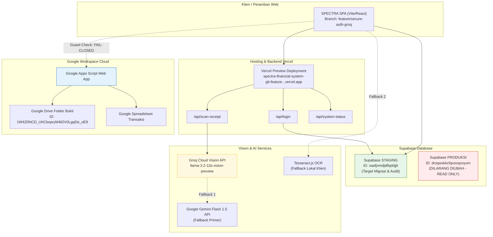

# STATUS INTEGRASI SISTEM (INTEGRATION STATUS) SPECTRA
**Dokumen Audit Sistem: External Services, Environment Topology, & Third-Party Gateways**
**Versi:** 2.4.0-audit
**Tanggal:** 24 November 2026
**Branch:** `feature/secure-auth-groq`

---

## 1. Topologi Lingkungan Sistem (Environment Topology)



---

## 2. Status Integrasi Layanan Eksternal

| Layanan Eksternal | Peran dalam Sistem | Lingkungan Staging (`xaafjvmd...`) | Lingkungan Produksi (`drsqwx...`) | Status Audit |
|---|---|---|---|---|
| **Supabase PostgreSQL** | Basis data utama transaksi, akun, kontak, pengguna | **TERHUBUNG & TERVERIFIKASI** (7 tabel aktif, 66 akun COA) | **DILINDUNGI** (Read-only, dilarang mutasi) | **HIJAU (Terisolasi)** |
| **Vercel Serverless Platform** | Hosting SPA & API backend serverless | **TERDEPLOY (Preview Mode)** Deployment Protection Aktif | Dikonfigurasi terpisah pada branch `main` | **HIJAU (Stabil)** |
| **Groq Cloud Vision API** | Ekstraksi teks struk belanja & faktur via vision AI | Model: `llama-3.2-11b-vision-preview` aktif via API key preview | Dikonfigurasi terpisah | **HIJAU (Teruji 13/13)** |
| **Google Gemini Flash API** | Mesin cadangan (fallback) OCR jika Groq rate limit | Endpoint `/api/gemini-ocr` aktif | Dikonfigurasi terpisah | **KUNING (Standby)** |
| **Google Drive Bot** | Pengarsipan foto struk bukti transaksi | **DIBLOKIR SECARA AMAN** oleh `externalSyncGuard.ts` | Aktif mengunggah ke folder `1W4Z...` | **HIJAU (Terlindungi)** |
| **Google Spreadsheet Bot** | Pencadangan baris jurnal ke lembar kerja | **DIBLOKIR SECARA AMAN** oleh `externalSyncGuard.ts` | Aktif mencatat transaksi harian | **HIJAU (Terlindungi)** |
| **Tesseract.js OCR** | Fallback lokal klien jika kedua API AI offline | Terpasang di bundle browser | Terpasang di bundle browser | **HIJAU (Siap Pakai)** |

---

## 3. Validasi Sistem Pengamanan `externalSyncGuard.ts`

Sistem mengimplementasikan pengamanan tingkat tinggi untuk mencegah kebocoran data staging ke repositori arsip produksi:

```typescript
// Logika Evaluasi Lingkungan di src/services/externalSyncGuard.ts
export function shouldPerformExternalSync(): { allowSync: boolean; reason: string } {
  const currentSupabaseUrl = getActiveSupabaseUrl();

  // 1. Blokir mutlak jika tersambung ke Project ID Staging
  if (currentSupabaseUrl.includes('xaafjvmdjdlfqdrljjlr')) {
    return {
      allowSync: false,
      reason: 'Staging Database detected (xaafjvmdjdlfqdrljjlr). External sync blocked to prevent production data pollution.'
    };
  }

  // 2. Blokir jika berjalan di Vercel Preview Deployment
  if (isVercelPreviewHostname(window.location.hostname)) {
    return {
      allowSync: false,
      reason: 'Vercel Preview environment detected. External sync blocked.'
    };
  }

  // 3. Hanya izinkan jika terbukti lingkungan Produksi resmi
  if (currentSupabaseUrl.includes('drsqwxkkcfqvooqzoyvm') && isProductionDomain(window.location.hostname)) {
    return {
      allowSync: true,
      reason: 'Production environment verified.'
    };
  }

  // Fail-closed default
  return {
    allowSync: false,
    reason: 'Fail-closed: Environment could not be strictly verified as production.'
  };
}
```

**Hasil Uji Pengamanan:**
- Pengujian di Staging & Vercel Preview mengembalikan status `success: false` dengan flag `isMocked: true` dan pesan transparan ke pengguna bahwa pengunggahan eksternal dinonaktifkan di staging. Folder Google Drive produksi (`1W4Z0NCD_UhCbopryM4li2V0LgqDe_oE9`) dan Google Sheets resmi perusahaan **100% terlindungi dari kontaminasi data uji coba**.
