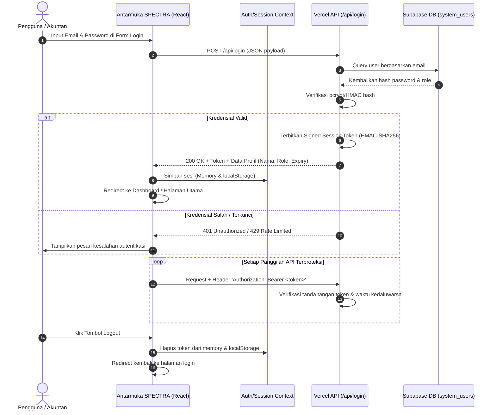
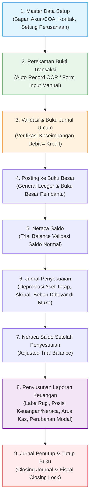
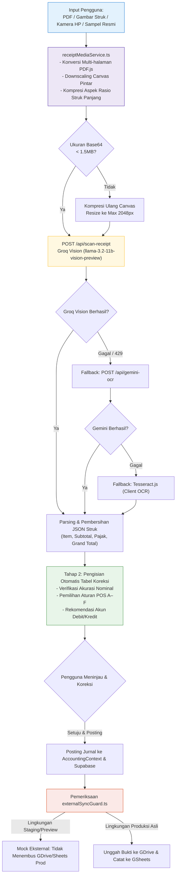
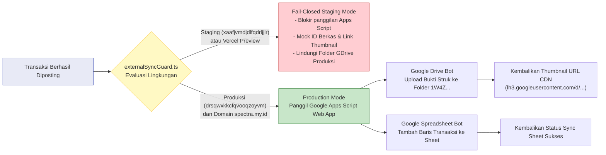
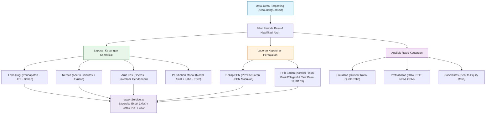

# PETA ALUR KERJA SISTEM (WORKFLOW MAP) SPECTRA
**Dokumen Audit Sistem: End-to-End Workflow & Business Process Mapping**
**Versi:** 2.4.0-audit
**Tanggal:** 24 November 2026
**Branch:** `feature/secure-auth-groq`

---

## 1. Ikhtisar Alur Kerja Sistem
SPECTRA Financial System dirancang untuk mengotomasi siklus akuntansi standar entitas bisnis secara menyeluruh dengan mengintegrasikan antarmuka web modern, pemrosesan kecerdasan buatan (Vision AI), sinkronisasi cloud real-time, dan pelaporan keuangan kepatuhan fiskal Indonesia.

Dokumen ini memetakan lima alur kerja (workflow) inti SPECTRA:
1. **Workflow 1:** Siklus Autentikasi dan Manajemen Sesi Pengguna
2. **Workflow 2:** Siklus Akuntansi Penuh (Accounting Cycle)
3. **Workflow 3:** Perekaman Otomatis Bukti Transaksi (Auto Record Pipeline)
4. **Workflow 4:** Sinkronisasi Eksternal & Pencadangan Otomatis (Google Drive & Sheets)
5. **Workflow 5:** Pelaporan Keuangan, Perpajakan, dan Analisis Fiskal

---

## 2. Workflow 1: Siklus Autentikasi & Manajemen Sesi

### Rincian Alur Autentikasi:
1. **Penerbitan Sesi:** Autentikasi diproses secara aman di backend serverless (`/api/login`), tidak membocorkan hash password ke klien browser.
2. **Penyimpanan Token:** Klien menyimpan token sesi di `localStorage` (`spectra_session_token`) untuk menjaga persistensi sesi saat reload halaman.
3. **Pemeriksaan Hak Akses (RBAC):** Sistem membedakan hak akses berdasarkan tiga tingkat peran:
   - `superadmin`: Akses penuh konfigurasi sistem, manajemen pengguna, dan reset database.
   - `admin`: Pengelolaan transaksi harian, edit master akun, dan ekspor laporan.
   - `auditor` / `viewer`: Akses read-only untuk pemeriksaan pembukuan dan audit trail.

---

## 3. Workflow 2: Siklus Akuntansi Penuh (The Accounting Cycle)

### Tahapan Operasional Siklus:
1. **Master Data:** Menyiapkan 66 akun default standar SAK Indonesia yang diklasifikasikan ke dalam 5 kategori besar (Aset, Liabilitas, Ekuitas, Pendapatan, Beban).
2. **Transaksi & Jurnal:** Setiap transaksi dicatat secara berpasangan ganda (*double-entry bookkeeping*). Sistem secara otomatis menolak transaksi jika `Total Debit != Total Kredit`.
3. **Buku Besar:** Mutasi transaksi dikelompokkan per kode akun akuntansi, menghitung saldo berjalan secara real-time.
4. **Neraca Saldo:** Memeriksa kesetaraan total saldo debit dan kredit seluruh akun sebelum laporan disusun.
5. **Penyesuaian:** Mengkalkulasi penyusutan aset tetap secara berkala berdasarkan metode garis lurus (*straight-line depreciation*).
6. **Laporan Keuangan:** Menyajikan Laba Rugi komprehensif, Neraca Posisi Keuangan, Laporan Arus Kas (Metode Langsung & Tidak Langsung), serta Laporan Perubahan Ekuitas.
7. **Tutup Buku:** Mengunci periode pembukuan lampau agar tidak dapat dimutasi atau dimanipulasi (*lock date enforcement*).

---

## 4. Workflow 3: Perekaman Otomatis Bukti Transaksi (Auto Record Pipeline)

### Detail Teknis Pipeline Auto Record:
1. **Multi-page Batch Processing:** Dokumen PDF diproses per halaman menggunakan `pdfjs-dist/build/pdf.worker.min.mjs` secara asinkron.
2. **Deduplikasi Cerdas:** Menghindari penghitungan ganda atas subtotal/total yang tercetak di beberapa halaman struk faktur yang panjang.
3. **Mesin Rekomendasi Jurnal (POS Engine):**
   - **POS A (Penjualan Tunai):** Debit Kas/Bank, Kredit Pendapatan Penjualan, Kredit Utang PPN.
   - **POS B (Pembelian Barang Dagang):** Debit Persediaan, Debit PPN Masukan, Kredit Kas/Utang Usaha.
   - **POS C (Beban Operasional):** Debit Beban Terkait (Listrik/Air/Internet), Kredit Kas/Bank.
   - **POS D (Beban Administrasi & Umum):** Debit Beban ATK/Transport, Kredit Kas Kecil.
   - **POS E (Perolehan Aset Tetap):** Debit Peralatan/Kendaraan, Kredit Kas/Utang.
   - **POS F (Pengeluaran Lain-lain):** Debit Beban Lain-lain, Kredit Kas.

---

## 5. Workflow 4: Sinkronisasi Eksternal & Pencadangan Otomatis

### Mekanisme Pengamanan Sinkronisasi:
- **Pencegahan Kontaminasi Staging:** Mengingat ID folder Google Drive (`1W4Z0NCD_UhCbopryM4li2V0LgqDe_oE9`) adalah repositori arsip produksi, sistem secara ketat memutus koneksi upload saat dijalankan di staging atau pratinjau Vercel.
- **Fail-Closed Strategy:** Jika penentuan lingkungan ambigu, sistem memilih untuk tidak menyinkronkan data eksternal (*fail-closed*) guna mencegah kebocoran data staging ke lembar kerja resmi perusahaan.

---

## 6. Workflow 5: Pelaporan Keuangan, Perpajakan, dan Analisis Fiskal

### Integrasi Pelaporan:
- **Koreksi Fiskal Otomatis:** Memisahkan beban non-deductible expense (biaya representasi tanpa daftar nominatif, sumbangan, sanksi administrasi pajak) untuk menghitung Penghasilan Kena Pajak (PhKP) sesuai UU HPP.
- **Ekspor Format Siap Audit:** Menyediakan format cetak standar akuntansi yang kompatibel dengan format kertas kerja auditor publik (KAP) dan konsultan pajak.
